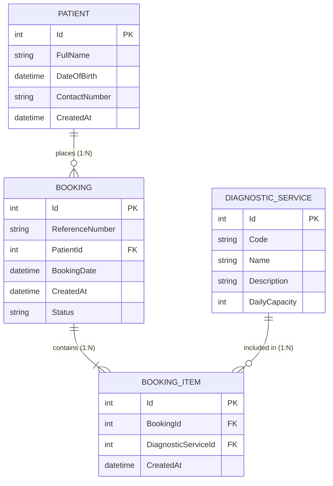

# Relational Design

## Entity-Relationship Diagram

## Tables and Relationships

| Entity | Primary Key | Foreign Keys / Constraints | Description |
| :--- | :--- | :--- | :--- |
| **Patient** | `Id` (Auto) | None | Existing patient registry (fictional seed data). |
| **DiagnosticService** | `Id` (Auto) | `Code` (Unique), `DailyCapacity > 0` | Services offered with fixed daily booking capacity limits. |
| **Booking** | `Id` (Auto) | `PatientId` -> `Patient.Id`, `ReferenceNumber` (Unique) | Booking header for a patient on a specific date. |
| **BookingItem** | `Id` (Auto) | `BookingId` -> `Booking.Id` (Cascade), `DiagnosticServiceId` -> `DiagnosticService.Id` (Restrict) | Junction line item; composite index `(BookingId, DiagnosticServiceId)` prevents duplicate services. |
